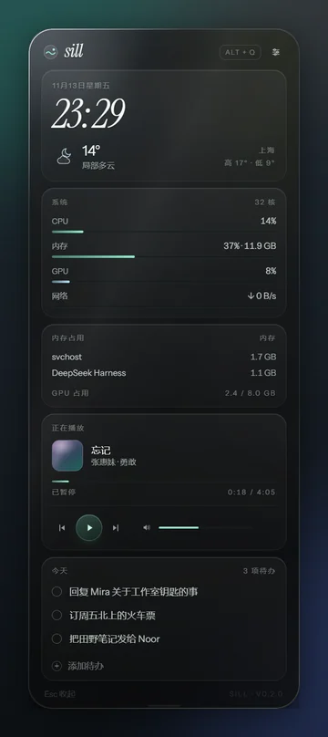
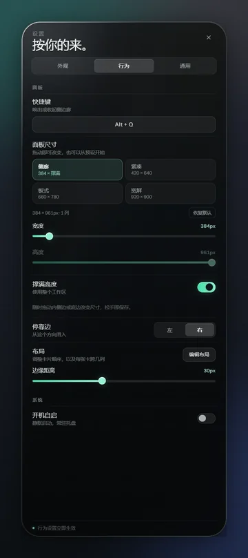

# Sill


[](https://github.com/Enkrid-Rao/sill/releases)
[](https://github.com/Enkrid-Rao/sill/actions/workflows/verify.yml)

A glass side rail for the Windows desktop: summon it with a hotkey, docked to the edge of the screen,
built to host installable widgets — and eventually to eat Rainmeter skins.

**English** · [中文](README_zh.md)

<table>
  <tr>
    <td align="center"><br>
      <sub>The rail: live system, media and todo data on one piece of glass</sub></td>
    <td align="center"><br>
      <sub>Settings: appearance / behavior / general</sub></td>
  </tr>
</table>

## Where it is now

- **M0 shell — done.** A real Electron transparent window, docked to the screen edge, summoned with
  `Alt+Q`, dismissed with `Esc` or a click outside. **Resize it like an iPad panel**: drag the inner edge, the bottom edge
  or the bottom corner; four presets (rail / compact / board / wide) are just starting points.
  The content reflows from one to three columns as it widens.
- **Settings — in.** Five sections (Appearance / Panel / Data / System / General), 8 theme presets,
  accent colours, hotkey recorder, free panel size (drag, sliders, presets, fill-height), dock side,
  edge distance, zh/en switch, weather location (auto or 28 cities), monitor refresh, per-widget
  visibility, an option to open Settings in its own window, and automatic updates.
- **Layout — editable.** Drag a card onto another to swap, or use the arrows, and set how many columns
  each card spans. The arrangement lives in `layout.json`; hidden widgets keep their slot.
- **Widget platform — in.** Cards render from a registry (`WidgetShell` + `WIDGETS`). Template
  widgets install from `.sill`, run in a Shadow DOM inside the card, and use host providers for
  time / system / media / weather / todo. Text, i18n, conditions, repeat, actions and meter bindings
  are implemented; the built-in five remain React components.
- **Widget CLI — in.** `pnpm sill validate / pack / new / dev`; local `.sill` install asks for
  id / version / author / permissions before writing.
- **Live data — in.** CPU, memory, GPU, network, top processes, Windows SMTC now-playing with
  play/pause, previous/next and system volume, real weather (Open-Meteo), and an editable todo list
  stored in `todo.json`. Completed tasks stay in place; deletes fade horizontally while the row
  height collapses, so nothing jumps up or down. The todo card has **Open / Closed / All**, inline
  edit, and a 5-second undo. The system monitor refreshes at a configurable **1 / 2 / 3 / 5 s**
  interval, and its readings ease between samples instead of snapping. The collector stays warm
  while the panel is hidden, so GPU, network and process fields are already populated on the
  first frame after summoning the rail.
- **Weather — real.** Auto-locate by coarse IP, or pick one of 28 cities in Settings. The hero card
  shows the current temperature, WMO condition, high/low and city; last good data is cached and
  retried after a network failure. Attribution: Open-Meteo / ipwho.is.
- **Dismiss on outside click.** Clicking anywhere outside the rail folds it away, except while
  Settings or layout editing is open, or when the click is on the tray icon.
- **Chinese type — tuned.** Chinese no longer inherits the 9–10px English caption sizes: it gets a
  YaHei fallback, 11.5–14px body/caption sizes, tighter tracking, higher faint-text contrast and
  subpixel rendering; English keeps Instrument Sans.
- **M0.5 — installer done.** `pnpm dist` builds an NSIS per-user installer. Installed builds use
  electron-updater for automatic background download and install-on-quit/restart; portable ZIPs
  update by replacing the folder manually.
- **Uninstall — in Settings.** General → Data & uninstall shows where your data lives and offers
  *Open folder* and *Uninstall Sill*. Installed builds launch the official NSIS uninstaller, with an
  optional checkbox to clear `%APPDATA%\Sill` too; portable builds quit and delete the whole folder,
  including `Sill-data`.

## Install

Grab `Sill-Setup-0.5.4.exe` or the portable ZIP `Sill-0.5.4-portable-win64.zip`
from [Releases](https://github.com/Enkrid-Rao/sill/releases).
It installs per-user to `%LOCALAPPDATA%\Programs\Sill` (no admin prompt). The build is **unsigned**,
so SmartScreen warns once — choose “More info → Run anyway”.

The **portable** build is a normal folder in a ZIP: extract the `Sill` folder to any writable
location, then run `Sill.exe`. No installer, no uninstall registry entry, no Program Files, and no
temporary extraction. It keeps `settings.json`, `todo.json`, `layout.json` and `weather.json` in a
visible `Sill-data` folder next to `Sill.exe`; moving the folder keeps the data with it. To remove it,
use Settings → General → Data & uninstall (quits, then deletes the whole folder) or simply delete the
folder after quitting. Do not put it in `Program Files` (it may be read-only).
The source is currently at **v0.5.4** (adds the Settings uninstall entry on top of v0.5.3's real
weather, click-outside dismissal, todo filters/edit/undo, portable build, adjustable monitor refresh,
five-section Settings and installed-build auto-updates); v0.5.4 is the latest published release.

The widget platform (templates, `.sill` install, dynamic layout, CLI, actions) is on `main` and is
**not** part of the 0.5.4 release. Run it from source or install a local `.sill` from a dev build.

Requires Windows 10/11 x64.

## Development

```powershell
pnpm install
pnpm approve-builds --all              # pnpm 10+ skips dependency build scripts by default
Remove-Item Env:ELECTRON_RUN_AS_NODE   # injected by the Electron host; must be removed, not just cleared
pnpm dev
```

`Alt+Q` summons / hides the rail, `Esc` dismisses it (closing Settings first), and a click outside
folds it away unless Settings or layout editing is open. The sliders icon in the
top-right corner opens Settings. **Drag the left/inner edge or the bottom edge to resize** — the panel
snaps to the four presets and remembers its size.

Self-checks:

```powershell
pnpm typecheck   # main + renderer
pnpm test        # package + provider unit tests
pnpm build       # output in apps/desktop/out
pnpm smoke       # headless panel → screenshot to apps/desktop/out/smoke.png → exit
pnpm dist        # NSIS installer → apps/desktop/dist
```

## Docs

| Doc | What it covers | For |
|---|---|---|
| [DEVPLAN.md](DEVPLAN.md) | historical planning, milestones, IR / rmskin strategy | understanding **how it got here** |
| [docs/DEVELOPMENT.md](docs/DEVELOPMENT.md) | environment, commands, layout, implementation decisions, troubleshooting | **changing the code** |
| [docs/ARCHITECTURE.md](docs/ARCHITECTURE.md) | process boundaries, data flow, widget runtime, extension points | **changing the architecture** |
| [docs/HANDOFF.md](docs/HANDOFF.md) | current state, verified vs. unverified, blockers, next steps | **picking it up** |
| [docs/WEB-WIDGETS.md](docs/WEB-WIDGETS.md) | webview JS prototype, bridge, security, limits | **writing a JS widget** |`n| [CONTRIBUTING.md](CONTRIBUTING.md) | setup, tests, commit and review rules | **sending a patch** |
| [SECURITY.md](SECURITY.md) | threat model and disclosure | **reporting a vulnerability** |
| [docs/mockups/panel-forms.html](docs/mockups/panel-forms.html) | four panel shapes at 1:1 scale | why the side rail |

## Component development

The template format, manifest, providers, package and security spec live in the separate
**[Sill-Components](https://github.com/Enkrid-Rao/sill-components)** repository. Start with
[docs/template.md](https://github.com/Enkrid-Rao/sill-components/blob/main/docs/template.md) and
[docs/package.md](https://github.com/Enkrid-Rao/sill-components/blob/main/docs/package.md).
Sill keeps the host (`WidgetShell`, `WIDGETS`, providers) and the built-in components.

A `type: "web"` prototype also exists: full HTML/CSS/JS in a transparent webview guest with a
`sill.ready / onData / command` bridge. It is dev-only and not installable yet; see
[docs/WEB-WIDGETS.md](docs/WEB-WIDGETS.md).

## Naming

Brand **Sill** (the window ledge), CLI `sill`, package format `.sill`, package ids `sill.*`,
data under `%APPDATA%\Sill\`. The reasoning is in [DEVPLAN §2](DEVPLAN.md).
