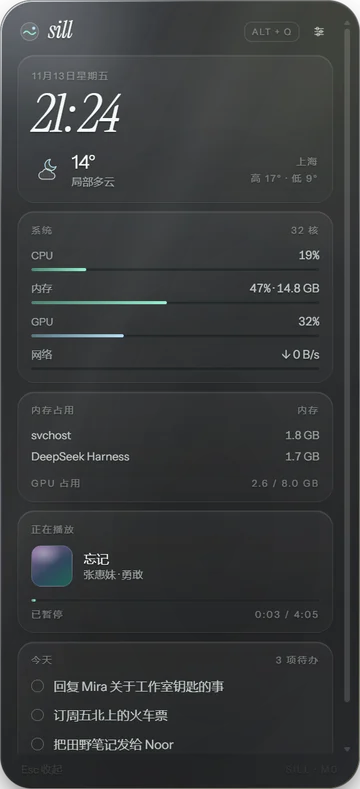
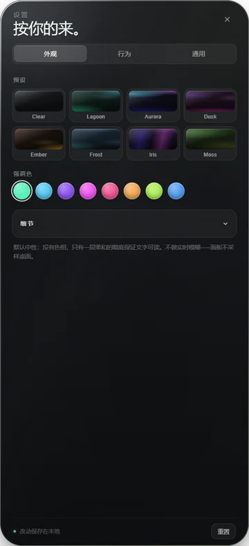

# Sill


[](https://github.com/Enkrid-Rao/sill/releases)

A glass side rail for the Windows desktop: summon it with a hotkey, docked to the edge of the screen,
built to host installable widgets — and eventually to eat Rainmeter skins.

**English** · [中文](README_zh.md)

<table>
  <tr>
    <td align="center"><br>
      <sub>The rail: live system, media and todo data on one piece of glass</sub></td>
    <td align="center"><br>
      <sub>Settings: appearance / behavior / general</sub></td>
  </tr>
</table>

## Where it is now

- **M0 shell — done.** A real Electron transparent window, docked to the screen edge, summoned with
  `Alt+Q`, dismissed with `Esc`. Four shapes: rail / compact / board / wide.
- **Settings — in.** Three tabs (Appearance / Behavior / General), 8 theme presets, accent colours,
  hotkey recorder, panel shapes, dock side, edge distance, zh/en switch.
- **Layout — editable.** Drag a card onto another to swap, or use the arrows, and set how many columns
  each card spans. The arrangement lives in `layout.json`.
- **Live data — in.** CPU, memory, GPU, network, top processes, Windows SMTC now-playing, and an
  editable todo list stored in `todo.json`. **Weather is still a placeholder.**
- **M0.5 — installer done.** `pnpm dist` builds an NSIS per-user installer; the app has an
  auto/manual release check. Auto-update installation is not wired yet.
- **M1 widget engine — not started.** The cards are still hand-written placeholders in `App.tsx`.

## Install

Grab `Sill-Setup-0.1.3.exe` from [Releases](https://github.com/Enkrid-Rao/sill/releases).
It installs per-user to `%LOCALAPPDATA%\Programs\Sill` (no admin prompt). The build is **unsigned**,
so SmartScreen warns once — choose “More info → Run anyway”.

Requires Windows 10/11 x64.

## Development

```powershell
pnpm install
pnpm approve-builds --all              # pnpm 10+ skips dependency build scripts by default
Remove-Item Env:ELECTRON_RUN_AS_NODE   # injected by the Electron host; must be removed, not just cleared
pnpm dev
```

`Alt+Q` summons / hides the rail, `Esc` dismisses it (closing Settings first). The sliders icon in the
top-right corner opens Settings.

Self-checks:

```powershell
pnpm typecheck   # main + renderer
pnpm build       # output in apps/desktop/out
pnpm smoke       # headless panel → screenshot to apps/desktop/out/smoke.png → exit
pnpm dist        # NSIS installer → apps/desktop/dist
```

## Docs

| Doc | What it covers | For |
|---|---|---|
| [DEVPLAN.md](DEVPLAN.md) | product and architecture, milestones, widget spec, rmskin strategy | understanding **what it should become** |
| [docs/DEVELOPMENT.md](docs/DEVELOPMENT.md) | environment, commands, layout, implementation decisions, troubleshooting | **changing the code** |
| [docs/HANDOFF.md](docs/HANDOFF.md) | current state, verified vs. unverified, blockers, next steps | **picking it up** |
| [docs/mockups/panel-forms.html](docs/mockups/panel-forms.html) | four panel shapes at 1:1 scale | why the side rail |

## Naming

Brand **Sill** (the window ledge), CLI `sill`, package format `.sill`, package ids `sill.*`,
data under `%APPDATA%\Sill\`. The reasoning is in [DEVPLAN §2](DEVPLAN.md).
