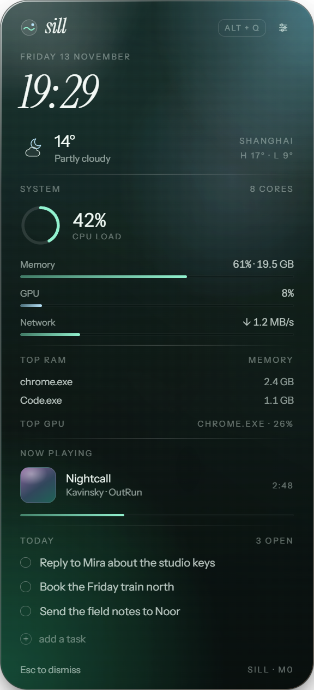
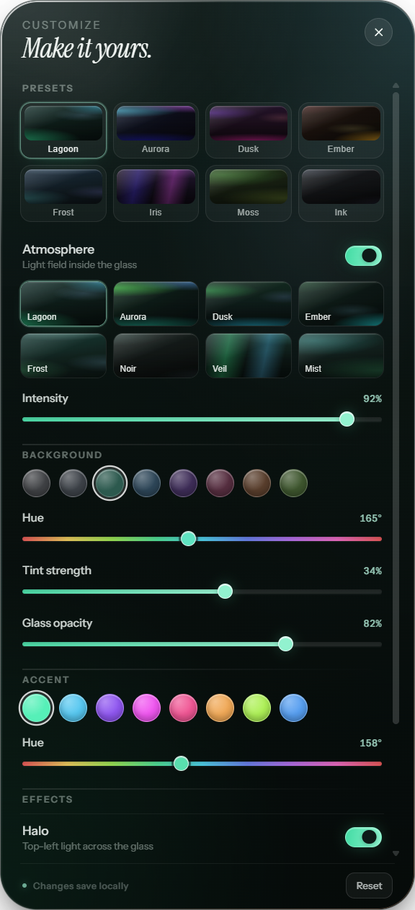

# Sill

Windows 桌面上的玻璃侧边廊：热键唤出，组件可安装、可写，能吃下 Rainmeter 的皮肤。



*上图为 M0 实机截图（`pnpm smoke` 捕获，透明窗口不含桌面背景，实际观感更透）。*



*面板右上角主题按钮拉起的 Customize：8 套预设、背景色相/上色强度、强调色、8 种氛围、顶光与颗粒，实时生效并落盘。*

## 现在到哪了

M0 工程骨架**已跑通**：面板能真的创建、显示、按几何停靠、截图，时钟是活的。
面板内的**主题系统**也已跑通：玻璃的颜色与氛围是 7 个 token 推出来的，可以在面板里直接调。
组件引擎（M1）还没开始，面板里的系统/天气/媒体/待办数据都是占位常量。

## 文档

| 文档 | 内容 | 读者 |
|---|---|---|
| [DEVPLAN.md](DEVPLAN.md) | 产品与架构规划、里程碑、组件规范、rmskin 策略 | 想理解**要做成什么**的人 |
| [docs/DEVELOPMENT.md](docs/DEVELOPMENT.md) | 环境、命令、目录职责、关键实现决策、排错 | 要**动手改代码**的人 |
| [docs/HANDOFF.md](docs/HANDOFF.md) | 当前进度、已验证/未验证、阻塞、下一步 | 要**接手**的人或下一个会话 |
| [docs/mockups/panel-forms.html](docs/mockups/panel-forms.html) | 四种面板形态的实尺对比（按 1/2/3/4 切换） | 想回看**为什么选侧边廊**的人 |

## 快速开始

```powershell
pnpm install
pnpm approve-builds --all          # 首次必须：pnpm 10+ 默认不跑依赖的安装脚本
Remove-Item Env:ELECTRON_RUN_AS_NODE   # 首次必须：清掉 Electron 宿主注入的变量（置空无效，必须移除）
pnpm dev
```

`Alt+Q` 唤出 / 收起，`Esc` 收起（开着 Customize 时先关那一层），托盘菜单里有换边、自启、置顶。
主题入口在面板右上角的滑杆按钮。

三条自检命令：

```powershell
pnpm typecheck   # 主进程与渲染进程各查一遍
pnpm build       # 产物在 apps/desktop/out
pnpm smoke       # 无头起面板 → 截图到 apps/desktop/out/smoke.png → 退出
```

## 命名

品牌 **Sill**（窗台），命令行 `sill`，包格式 `.sill`，包 id `sill.*`，数据目录 `%APPDATA%\Sill\`。
名字的理由见 [DEVPLAN.md §2](DEVPLAN.md)。
