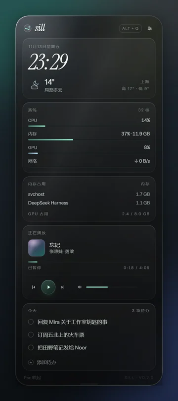
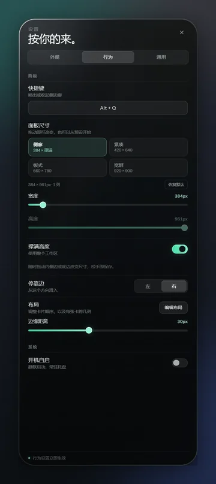

# Sill


[](https://github.com/Enkrid-Rao/sill/releases)
[](https://github.com/Enkrid-Rao/sill/actions/workflows/verify.yml)

Windows 桌面上的玻璃侧边廊：热键唤出，停靠在屏幕边缘，用来承载可安装的组件——将来还要吃下 Rainmeter 皮肤。

[English](README.md) · **中文**

<table>
  <tr>
    <td align="center"><br>
      <sub>侧边廊：系统、媒体、待办的真实数据，同一块玻璃</sub></td>
    <td align="center"><br>
      <sub>设置：外观 / 面板 / 组件</sub></td>
  </tr>
</table>

## 现在到哪了

- **M0 骨架——已完成。** 真的 Electron 透明窗口，停靠屏幕边缘，`Alt+Q` 唤出，`Esc` 或点面板外收起。
  **面板像 iPad 一样自由缩放**：拖内侧边、底边或内下角；侧廊 / 紧凑 / 板式 / 宽屏只是四个起点，
  宽到一定程度内容自动从一列变两列、三列。
- **设置——已落地。** 外观 / 面板 / 组件 / 数据 / 通用五段式；8 套主题预设、强调色、热键录制、自由面板尺寸
  （拖拽 / 滑杆 / 预设 / 撑满高度）、停靠边、边缘距离、中英切换、天气地区（自动或 28 个城市）、
  监测刷新频率、每个组件的显隐、「设置页使用独立窗口」开关，以及自动更新。
- **布局——流式或自由。** 新装默认自由：每张卡可放任意 x/y/w/h，布局编辑里可拖拽和缩放。
  旧的流式网格在 设置 → 面板 → 布局模式 里保留。两者都存 `layout.json`，隐藏状态不丢。
- **快捷方式收纳——已落地。** 收纳盒卡片保存 `.lnk` / `.exe`，显示系统图标，点击打开、可删除。
  它是收纳盒，不是文件管理器。
- **组件平台——已落地。** 卡片从注册表（`WidgetShell` + `WIDGETS`）渲染。模板组件从 `.sill`
  安装，在卡片的 Shadow DOM 里运行，用宿主的 time / system / media / weather / todo provider；
  文本、i18n、条件、repeat、动作和 meter 都已支持；`system` / `processes` 已作为模板包随应用发布，
hero、media、shelf、todo 暂时仍是 React 实现。
- **组件 CLI——已落地。** 独立 `sill-cli`（`npm i -g @heavenlydemon/sill-cli`，命令 `sill new / dev / pack`）可以不碰源码，直接面向
  已安装或便携版 Sill；`sill dev` 用独立 `Sill-dev` 数据并热重载。本地 `.sill` 安装前会确认
  id / 版本 / 作者 / 权限。
- **`.sill` 文件关联——已落地。** 安装版自动注册当前用户级关联：双击或右键 `.sill` →
  *Install with Sill*，走的还是同一套确认流程。绿色版可以在 设置 → 组件 里手动注册 / 取消。
- **真实数据——已接入。** CPU、内存、GPU、网络、TOP 进程、Windows SMTC 正在播放（含播放 / 暂停、
  上一首 / 下一首、系统音量）、真实天气（Open-Meteo），以及可编辑的待办（存在 `todo.json`）。
  勾选后任务留在原位，删除只做横向淡出与行高收合，不会上下跳动。待办卡支持
  **Open / Closed / All（未完成 / 已完成 / 全部）**、行内编辑和 5 秒撤销。系统监测支持
  **1 / 2 / 3 / 5 秒** 可调刷新，读数会在两次采样之间平滑过渡，不再突然跳变；collector 在面板
  隐藏时保持预热，唤出后的第一帧就有 GPU、网速和进程数据。
- **天气——已接真实数据。** 自动按 IP 粗略定位，或在设置里从 28 个城市中选择；Hero 卡显示
  当前温度、WMO 天气、最高/最低与城市。最后一次成功数据会缓存，网络失败自动重试。
  数据来源：Open-Meteo；自动定位：ipwho.is。
- **点外收起。** 点击侧边廊外的任意位置会收起面板；设置 / 布局编辑打开时不收，
  托盘图标上的点击也不误判。
- **中文排版——单独调过。** 中文不再沿用英文 9–10px 的小字：雅黑回退、正文/说明 11.5–14px、
  页面标题 24px、收紧字距、提高浅色文字对比度，并恢复 Windows 次像素渲染；英文继续用 Instrument Sans。
- **M0.5——安装包已通。** `pnpm dist` 出 NSIS per-user 安装包；安装版用 electron-updater
  后台自动下载，退出时安装或重启更新；绿色 ZIP 需要手动替换文件夹。
- **卸载——设置里直接做。** 通用 → 数据与卸载会显示用户数据目录，并提供「打开文件夹」与
  「卸载 Sill」。安装版打开官方 NSIS 卸载器，可勾选同时删除 `%APPDATA%\Sill`；绿色版退出后
  删除整个文件夹（包括 `Sill-data`）。

## 0.6 开发者预览

`v0.6.0-dev.2` 预发布带安装包、便携版和独立 CLI：

- [Sill-Setup-0.6.0-dev.2.exe](https://github.com/Enkrid-Rao/sill/releases/download/v0.6.0-dev.2/Sill-Setup-0.6.0-dev.2.exe)
- [Sill-0.6.0-dev.2-portable-win64.zip](https://github.com/Enkrid-Rao/sill/releases/download/v0.6.0-dev.2/Sill-0.6.0-dev.2-portable-win64.zip)
- CLI：`npm i -g @heavenlydemon/sill-cli`（0.3.1）

这是开发者预览，不是稳定版 0.5.4。

## 安装

从 [Releases](https://github.com/Enkrid-Rao/sill/releases) 下载 `Sill-Setup-0.5.4.exe`，
或绿色版 ZIP `Sill-0.5.4-portable-win64.zip`。
per-user 安装到 `%LOCALAPPDATA%\Programs\Sill`，不弹 UAC。安装包**未签名**，SmartScreen 会拦一次，
点「更多信息 → 仍要运行」。

**绿色版**是普通文件夹 ZIP：把 `Sill` 文件夹解压到任意可写位置，双击 `Sill.exe` 即可。
没有安装程序、不写注册表卸载项、不碰 Program Files，也不会每次启动解压到临时目录。
`settings.json`、`todo.json`、`layout.json`、`weather.json` 都放在 `Sill.exe` 旁的 `Sill-data`；
移动整个文件夹时数据跟着走。卸载用设置 → 通用 → 数据与卸载（退出后删整个文件夹），
或退出后直接删文件夹。不要放在 `Program Files`（可能只读）。
源码当前是 **v0.5.4**（在 v0.5.3 的真实天气、点外收起、待办过滤/编辑/撤销、绿色版、可调监测刷新、
五段式设置、安装版自动更新之上，新增设置内卸载）；v0.5.4 是最新已发布版本。

组件平台（模板、`.sill` 安装、动态布局、CLI、动作）在 `main` 上，**不在** 0.5.4 发布版里。
要从源码运行，或在开发版里安装本地 `.sill`。

需要 Windows 10/11 x64。

## 开发

```powershell
pnpm install
pnpm approve-builds --all              # pnpm 10+ 默认不跑依赖的安装脚本
Remove-Item Env:ELECTRON_RUN_AS_NODE   # Electron 宿主会注入，必须移除而不是置空
pnpm dev
```

`Alt+Q` 唤出 / 收起，`Esc` 收起（开着设置时先关那一层），点面板外也会收起（设置 / 布局编辑时除外）。右上角滑杆图标进入设置。
**拖内侧边或底边即可改尺寸**——面板会吸附到四个预设，并记住大小。

自检命令：

```powershell
pnpm typecheck   # 主进程与渲染进程各查一遍
pnpm test        # 安装器 + provider 单元测试
pnpm build       # 产物在 apps/desktop/out
pnpm smoke       # 无头起面板 → 截图到 apps/desktop/out/smoke.png → 退出
pnpm dist        # NSIS 安装包 → apps/desktop/dist
```

## 文档

| 文档 | 内容 | 读者 |
|---|---|---|
| [DEVPLAN.md](DEVPLAN.md) | 历史规划、里程碑、IR / rmskin 策略 | 想理解**怎么走到这里**的人 |
| [docs/DEVELOPMENT.md](docs/DEVELOPMENT.md) | 环境、命令、目录职责、关键实现决策、排错 | 要**动手改代码**的人 |
| [docs/ARCHITECTURE.md](docs/ARCHITECTURE.md) | 进程边界、数据流、组件运行时、扩展点 | 要**改架构**的人 |
| [docs/LAYOUT.md](docs/LAYOUT.md) | 流式/自由布局、boxes、迁移 | 要**摆放组件**的人 |
| [docs/HANDOFF.md](docs/HANDOFF.md) | 当前进度、已验证 / 未验证、阻塞、下一步 | 要**接手**的人或下一个会话 |
| [docs/WEB-WIDGETS.md](docs/WEB-WIDGETS.md) | web 组件、trusted Node、沙箱桥 | 要**写 JS 组件**的人 |
| [docs/DEVELOPER-QUICKSTART.md](docs/DEVELOPER-QUICKSTART.md) | 装 CLI、new、dev、pack | 要**写第一个组件**的人 |
| [CONTRIBUTING.md](CONTRIBUTING.md) | 环境、测试、提交与 review 规则 | 要**发 patch** 的人 |
| [SECURITY.md](SECURITY.md) | 威胁模型与漏洞披露 | 要**报安全问题**的人 |
| [docs/mockups/panel-forms.html](docs/mockups/panel-forms.html) | 四种面板形态的实尺对比（按 1/2/3/4 切换） | 想回看**为什么选侧边廊**的人 |

## 组件开发

一个组件就是一个文件夹：`widget.json` + `ui/index.html`（可选 `style.css`、`main.js`、
`assets/**`）。就是普通的 HTML / CSS / JavaScript——没有模板语言，没有构建步骤。

```powershell
sill new clock        # 生成脚手架（npm i -g @heavenlydemon/sill-cli）
```

把文件夹放进 `%APPDATA%\Sill\skins\`（设置 → 组件 → 打开文件夹），勾选显示，然后直接改：
保存文件只会热重载这一个组件。`type: "template"` 在面板页面里运行，可以用
`sill.onData`、`sill.storage`、`sill.command`、`sill.onDispose`；按 `F12` 开 DevTools。
`type: "web"` 放进独立 guest，`trust: "trusted"` 时还能用完整 Node。

完整开发文档（API、主题变量、数据源、配方、常见坑、给 AI 的检查清单）在
**[Sill-Components](https://github.com/Enkrid-Rao/sill-components)** 仓库：
[docs/authoring.md](https://github.com/Enkrid-Rao/sill-components/blob/main/docs/authoring.md)。

trusted 的 web 组件是完整 Node 运行时，不是 provider 白名单：可以带 `ui/assets/**`，
通过 `sill.ready(({ dir }) => ...)` 拿包目录，直接调 WASAPI / PowerShell / C#。
看 [examples/dev-volume](examples/dev-volume)：一个真实的按应用调音量组件，没有为它新增宿主 API。

## 命名

品牌 **Sill**（窗台），命令行 `sill`，包格式 `.sill`，包 id `sill.*`，数据目录 `%APPDATA%\Sill\`。
名字的理由见 [DEVPLAN.md §2](DEVPLAN.md)。

