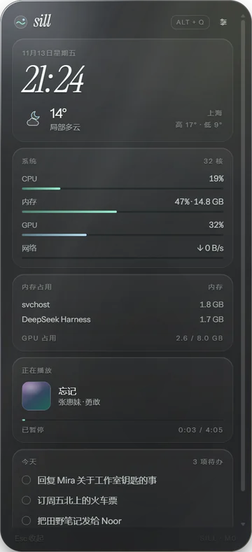
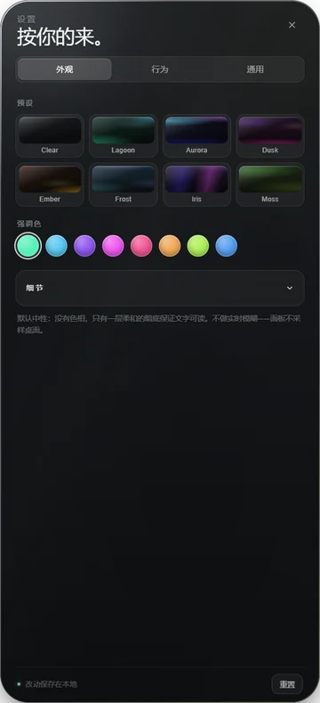

# Sill


[](https://github.com/Enkrid-Rao/sill/releases)

Windows 桌面上的玻璃侧边廊：热键唤出，停靠在屏幕边缘，用来承载可安装的组件——将来还要吃下 Rainmeter 皮肤。

[English](README.md) · **中文**

<table>
  <tr>
    <td align="center"><br>
      <sub>侧边廊：系统、媒体、待办的真实数据，同一块玻璃</sub></td>
    <td align="center"><br>
      <sub>设置：外观 / 行为 / 通用</sub></td>
  </tr>
</table>

## 现在到哪了

- **M0 骨架——已完成。** 真的 Electron 透明窗口，停靠屏幕边缘，`Alt+Q` 唤出，`Esc` 收起。
  四种形状：侧廊 / 紧凑 / 板式 / 宽屏。
- **设置——已落地。** 外观 / 行为 / 通用三页，8 套主题预设、强调色、热键录制、面板形状
  （侧廊 / 紧凑 / 板式 / 宽屏）、停靠边、边缘距离、中英切换。
- **布局——可编辑。** 把一张卡拖到另一张上即可换位，也可以用箭头；每张卡还能设跨几列。
  顺序与跨列存在 `layout.json`。
- **真实数据——已接入。** CPU、内存、GPU、网络、TOP 进程、Windows SMTC 正在播放，以及可编辑的待办
  （存在 `todo.json`）。**天气仍是占位。**
- **M0.5——安装包已通。** `pnpm dist` 出 NSIS per-user 安装包；应用能自动 / 手动检查新版本，
  自动下载安装还没接。
- **M1 组件引擎——还没开始。** 面板里的卡片仍然是 `App.tsx` 里手写的占位。

## 安装

从 [Releases](https://github.com/Enkrid-Rao/sill/releases) 下载 `Sill-Setup-0.1.3.exe`。
per-user 安装到 `%LOCALAPPDATA%\Programs\Sill`，不弹 UAC。安装包**未签名**，SmartScreen 会拦一次，
点「更多信息 → 仍要运行」。

需要 Windows 10/11 x64。

## 开发

```powershell
pnpm install
pnpm approve-builds --all              # pnpm 10+ 默认不跑依赖的安装脚本
Remove-Item Env:ELECTRON_RUN_AS_NODE   # Electron 宿主会注入，必须移除而不是置空
pnpm dev
```

`Alt+Q` 唤出 / 收起，`Esc` 收起（开着设置时先关那一层）。右上角滑杆图标进入设置。

自检命令：

```powershell
pnpm typecheck   # 主进程与渲染进程各查一遍
pnpm build       # 产物在 apps/desktop/out
pnpm smoke       # 无头起面板 → 截图到 apps/desktop/out/smoke.png → 退出
pnpm dist        # NSIS 安装包 → apps/desktop/dist
```

## 文档

| 文档 | 内容 | 读者 |
|---|---|---|
| [DEVPLAN.md](DEVPLAN.md) | 产品与架构规划、里程碑、组件规范、rmskin 策略 | 想理解**要做成什么**的人 |
| [docs/DEVELOPMENT.md](docs/DEVELOPMENT.md) | 环境、命令、目录职责、关键实现决策、排错 | 要**动手改代码**的人 |
| [docs/HANDOFF.md](docs/HANDOFF.md) | 当前进度、已验证 / 未验证、阻塞、下一步 | 要**接手**的人或下一个会话 |
| [docs/mockups/panel-forms.html](docs/mockups/panel-forms.html) | 四种面板形态的实尺对比（按 1/2/3/4 切换） | 想回看**为什么选侧边廊**的人 |

## 命名

品牌 **Sill**（窗台），命令行 `sill`，包格式 `.sill`，包 id `sill.*`，数据目录 `%APPDATA%\Sill\`。
名字的理由见 [DEVPLAN.md §2](DEVPLAN.md)。
